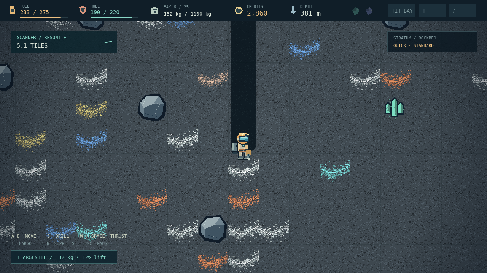

# DEEPCORE

**Depth is cheap. Height is expensive.** You're the last prospector on a dead mining world, with a drill, a jetpack, and a rocket that isn't built yet. Below your boots is a fortune. Above you is the only way home.

Cut a shaft through the topsoil, follow a mineral seam into the rockbed, and fill your cargo bay one vein at a time. Every kilogram changes the climb. A rich haul rises slowly, burns precious fuel, and can become too heavy to lift at all. Know when to turn back — or what to leave behind.

The surface is your lifeline. Sell your ore, mend your suit, refill the tank, and decide whether the next pile of Credits buys a better drill, a stronger jetpack, a field supply, or another piece of your escape rocket. Bank the expedition at the Save Pad. Choose Standard for a return to that last save, or Hardcore for a descent with no rescue.

Go deeper and the stone darkens. Faint gas wisps interrupt the silence; molten pools force your tunnels sideways. A scanner leads you toward rare crystals, but the final prize waits at the planet's Core. Extract its unstable Sample and the quiet turns into a countdown: ninety seconds to turn everything you've learned into one last climb.

